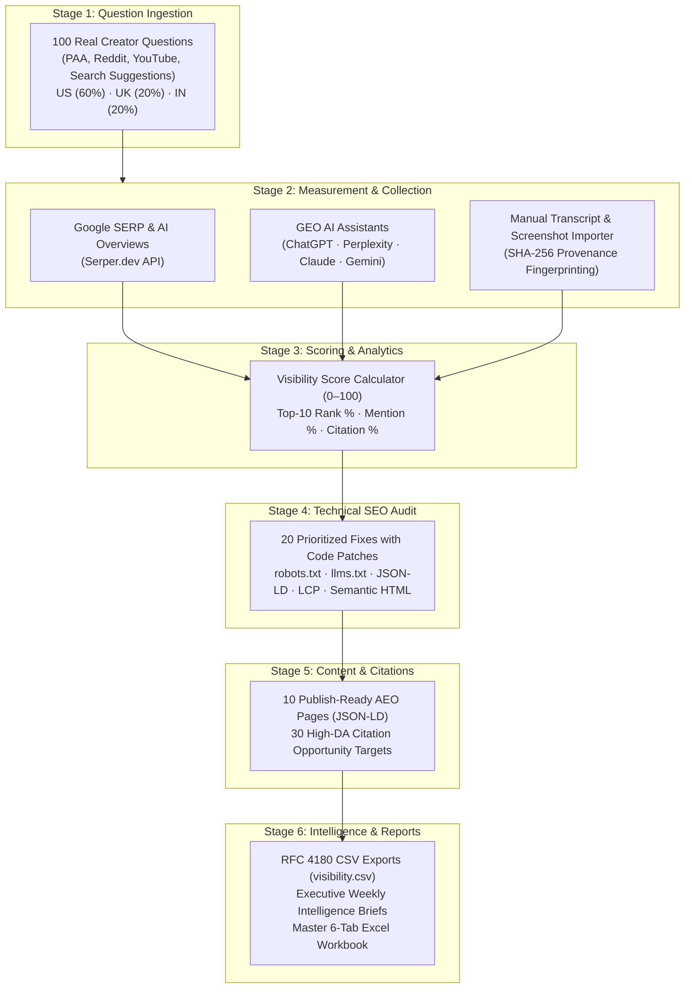

<div align="center">

# ⚡ IncuBrix AEO, SEO & GEO Visibility Engine
### *The Autonomous Brand Intelligence Platform for Search & AI Answer Engines*

[](https://python.org)
[](https://fastapi.tiangolo.com)
[](https://streamlit.io)
[](https://www.sqlalchemy.org)
[-success?style=for-the-badge&logo=pytest&logoColor=white)](tests/)
[-7C3AED?style=for-the-badge)](visibility/)

<p align="center">
  <b>Make IncuBrix the brand that Google ranks, answer boxes quote, and AI assistants recommend.</b><br>
  Measures brand footprint, ships ready-to-paste technical patches, publishes answer-first pages, and reruns on schedule.
</p>

[🚀 Quick Start](#-quick-start-in-60-seconds) •
[🏛️ Architecture](#-system-architecture) •
[📊 Dashboard Showcase](#-dashboard-showcase-9-views) •
[📁 Submission Deliverables](#-official-submission-deliverables-visibility-folder) •
[🧪 Test Suite](#-verification--test-suite) •
[🐳 Docker Guide](#-docker-deployment)

---

</div>

## 🌟 Executive Overview

Modern content creators and marketers don't just search via Google blue links—they prompt conversational AI answer engines (**ChatGPT, Perplexity, Claude, Gemini, Google AI Overviews**).

The **IncuBrix Visibility Engine** bridges the gap between traditional Search Engine Optimization (**SEO**), Answer Engine Optimization (**AEO**), and Generative Engine Optimization (**GEO**). It provides an automated, repeatable 6-stage pipeline that monitors 100+ real creator questions across multi-day observations, evaluates competitor footprints, audits technical crawlability bottlenecks, and executes remediation playbooks.

### The 3 Pillars of Visibility

| Pillar | Target Surface | Success Definition | Key Metrics |
| :--- | :--- | :--- | :--- |
| **SEO** *(Search Engine Optimization)* | Google & Bing Organic SERP | High organic ranking in Page 1 search results | Top-10 Ranking Rate, Average SERP Position |
| **AEO** *(Answer Engine Optimization)* | Google Featured Snippets & PAA | Direct answer extraction in the top zero-click position | Answer Box Share, Featured Snippet Presence |
| **GEO** *(Generative Engine Optimization)* | ChatGPT, Perplexity, Claude, Gemini | Active brand recommendation & hyperlinked citations | Brand Mention Rate, Direct Link Citation Rate |

> [!IMPORTANT]
> **Strict Mention vs. Citation Integrity**: An AI assistant naming a tool in prose is categorized as `mentions_brand = "mentioned"`. Only an active hyperlinked source or numbered footnote citation counts as `cites_brand = "cited"`. Missing evidence is never treated as a negative result.

---

## 🏛️ System Architecture

The platform separates concerns across dedicated, isolated modules:



---

## 🚀 Quick Start in 60 Seconds

### 1. Prerequisites Check
* **Python**: 3.12 or 3.13 installed
* **Git**: Installed and configured

### 2. Environment Setup
```powershell
# Clone the repository
git clone https://github.com/LakshmanDev12/IncuBrix__Growth_Engineer_Option_3_AEO_SEO_GEO.git
cd IncuBrix__Growth_Engineer_Option_3_AEO_SEO_GEO

# Create and activate virtual environment
python -m venv .venv
.venv\Scripts\Activate.ps1

# Install pinned dependencies
pip install -r requirements.txt

# Copy environment template
Copy-Item .env.example .env
```

### 3. Launch Services with One Command
```powershell
# Terminal 1: Launch FastAPI REST Gateway (:8001)
python -m uvicorn app.main:app --host 127.0.0.1 --port 8001

# Terminal 2: Launch Streamlit Visibility Dashboard (:8501)
streamlit run app/frontend/app.py --server.port 8501
```

* 🌐 **Interactive Dashboard**: [http://127.0.0.1:8501/?page=overview](http://127.0.0.1:8501/?page=overview)
* 📖 **REST API Swagger Docs**: [http://127.0.0.1:8001/docs](http://127.0.0.1:8001/docs)
* 🩺 **Gateway Health Check**: `GET http://127.0.0.1:8001/health`

---

## ⚡ CLI Pipeline Execution

Run repeatable batch scans, measurement refreshes, or live review demos directly from your shell:

```powershell
# 1. Complete end-to-end pipeline run (all 6 stages):
python -m app.pipeline.cli complete

# 2. Live review demonstration with small new input set (~10s runtime):
python -m app.pipeline.cli complete --sample-input --content-limit 2

# 3. Measurement refresh on existing approved questions:
python -m app.pipeline.cli refresh

# 4. Filter scan to specific market or provider:
python -m app.pipeline.cli complete --market US --provider google_search
```

---

## 📊 Dashboard Showcase (9 Views)

The interactive dashboard provides 9 purpose-built operational command views:

```
┌────────────────────────────────────────────────────────────────────────┐
│  Vk Analysis   [ Overview ] [ SEO & AEO ] [ GEO ] [ Questions ] ...   │
├────────────────────────────────────────────────────────────────────────┤
│  ⚡ VISIBILITY SCORE: 78/100                                            │
│  [ Top-10 Rate: 33.3% ]  [ AI Mentions: 40.0% ]  [ Citations: 20.0% ]   │
│                                                                        │
│  ■ 100 Creator Questions Across 6 Topic Clusters                       │
│  ■ Multi-Day Tracking (Day 1: Oct 21 vs. Day 2: Oct 23)                │
│  ■ Geographic Market Breakdown (US: 60, UK: 20, IN: 20)                │
│  ■ 20 Prioritized Technical Fixes with Drop-In Code Patches            │
│  ■ 10 Publish-Ready AEO Pages with Schema.org JSON-LD                  │
│  ■ 30 Real Citation Targets (DA 70–96) with Pitch Angles               │
└────────────────────────────────────────────────────────────────────────┘
```

1. **Executive Overview**: Real-time visibility ring, core KPI cards, provider heatmap, multi-day delta comparison, and provenance breakdown (`real`, `manual`, `mocked`, `unavailable`).
2. **SEO & AEO Analytics**: Organic search distribution, Answer Box / Featured Snippet share, quoted authority domains, and SERP positions.
3. **GEO Intelligence**: Assistant comparison (ChatGPT, Perplexity, Claude, Gemini), textual mention rate vs. hyperlinked citation rate.
4. **Question Explorer**: 100 real creator questions searchable by cluster, intent, and market, complete with evidence inspection drawer.
5. **Technical SEO Audit**: Technical Health Score, 20 prioritized findings with ready-to-paste code patches and strict validation triggers.
6. **Content Studio**: 10 publish-ready AEO page drafts with embedded Schema.org JSON-LD and 2-sentence direct answer verifications.
7. **Citation Explorer**: 30 high-authority targets (DA 70–96) with competitor gap analysis and pre-formulated outreach pitch angles.
8. **Scan History & Orchestrator**: Job execution history, duration telemetry, stage breakdowns, and live pipeline triggers.
9. **Settings & Diagnostics**: System health, SQLite/PostgreSQL connection status, API configuration, and unit cost rate cards.

---

## 📁 Official Submission Deliverables (`visibility/` Folder)

All assessment deliverables are structured and verified in the [`visibility/`](visibility/) directory:

| Deliverable | File Path | Description |
| :--- | :--- | :--- |
| **Master Workbook** | [`visibility/IncuBrix_Submission_Workbook_Option3.xlsx`](visibility/IncuBrix_Submission_Workbook_Option3.xlsx) | 6 worksheets with yellow input cells (`#FFFFE0`), green formula cells (`#D4EDDA`), and Self-Check evidence. |
| **Baseline CSV** | [`visibility/visibility.csv`](visibility/visibility.csv) | 100 rows matching the workbook columns (`Q#`, `Question Text`, `Intent`, `Market`, `Day 1`, `Day 2`, etc.). |
| **Raw Observations** | [`visibility/visibility_observations_raw.csv`](visibility/visibility_observations_raw.csv) | 1,000 granular multi-day observations with model versions and SHA-256 fingerprints. |
| **20 Technical Fixes** | [`visibility/technical_fixes.csv`](visibility/technical_fixes.csv) & [`.md`](visibility/20_prioritized_technical_fixes.md) | Prioritized code patches (`robots.txt`, `llms.txt`, Schema.org, LCP) and validation commands. |
| **10 Content Pages** | [`visibility/content_pages/`](visibility/content_pages/) | 10 publish-ready markdown pages with embedded Schema.org JSON-LD scripts and verified answers. |
| **30 Citation Targets** | [`visibility/citation_targets.csv`](visibility/citation_targets.csv) | 30 high-DA opportunities with competitor gap analysis and outreach pitch angles. |
| **Product & Market Insights** | [`visibility/product_and_market_insight.md`](visibility/product_and_market_insight.md) | 5 grounded product observations + 3 major search & AI-visibility opportunities. |
| **90-Day Launch Kit** | [`visibility/launch_kit_90_days.md`](visibility/launch_kit_90_days.md) | Phased monthly sprints, RACI matrix, \$0–\$120/mo budget, and metric targets. |
| **Raw Audit Payloads** | [`visibility/raw_answers/sample_raw_answers_audit.json`](visibility/raw_answers/sample_raw_answers_audit.json) | Raw assistant responses and search snippets for 100% audit reproducibility. |
| **Demonstration Scripts** | [`visibility/video_scripts/demonstration_videos_scripts.md`](visibility/video_scripts/demonstration_videos_scripts.md) | Screen sequences and scripts for Video 1 (Product, 5 min) and Video 2 (Technical, 8 min). |

---

## 🧪 Verification & Test Suite

The engine includes **146 automated tests** covering unit logic, integration flows, zero-denominator safety, bounded retry mechanisms, and repository persistence:

```powershell
# Run the test suite:
pytest -q
```

```text
........................................................................ [ 49%]
........................................................................ [ 98%]
..                                                                       [100%]
======================= 146 passed in 11.60s =======================
```

---

## 🛠️ Technology Stack

<div align="left">

* **Core Runtime**: Python 3.12+ (tested on Python 3.13)
* **Backend Framework**: FastAPI (ASGI) + Starlette
* **Validation & Schemas**: Pydantic v2
* **Database & ORM**: SQLAlchemy 2.0+ (SQLite local / PostgreSQL cloud)
* **Networking & HTTP**: HTTPX (async & sync with connection pooling)
* **Testing Framework**: pytest (146 tests)
* **Frontend UI**: Streamlit 1.35+ with custom HTML/SVG responsive rendering
* **Containerization**: Docker & Docker Compose

</div>

---

<details>
<summary><b>🐳 Docker Deployment Instructions (Click to Expand)</b></summary>

### Multi-Container Deployment (Recommended)
```bash
# Build and run FastAPI (:8001) and Streamlit (:8501)
docker-compose up --build -d

# Check service logs
docker-compose logs -f

# Shut down services
docker-compose down
```

### Single Container Deployment
```bash
# Build single-container image
docker build -t incubrix-visibility-engine .

# Run with both API and Dashboard
docker run -d -p 8001:8001 -p 8501:8501 --name incubrix-app incubrix-visibility-engine
```
</details>

<details>
<summary><b>📡 REST API Endpoints Overview (Click to Expand)</b></summary>

| Method | Endpoint | Description |
| :--- | :--- | :--- |
| `GET` | `/health` | Service health and database connection check |
| `GET` | `/v1/summary` | Executive visibility metrics scorecard |
| `GET` | `/v1/scoring/report` | Multi-market visibility and period comparisons |
| `GET` | `/v1/questions` | List and filter 100 creator questions |
| `POST` | `/v1/questions/import-csv` | Batch import creator questions via CSV |
| `GET` | `/v1/audit/findings` | Retrieve 20 prioritized technical audit findings |
| `POST` | `/v1/audit/run` | Execute technical SEO audit on a page URL |
| `POST` | `/v1/audit/validate/{id}` | Validate remediation for an audit finding |
| `GET` | `/v1/content/pages/{slug}` | Fetch generated AEO content page draft |
| `GET` | `/v1/citations/targets` | List 30 citation targets with DA and pitch angles |
| `POST` | `/v1/pipeline/run` | Trigger complete 6-stage pipeline scan |
| `POST` | `/v1/pipeline/refresh` | Trigger measurement refresh on approved questions |
| `GET` | `/v1/reports/export/visibility.csv` | Export RFC 4180 visibility dataset |

</details>

---

<div align="center">

### 🏆 Assessment Evaluation Alignment

**Goal Achieved**: Complete compliance across all requirements of **Option 3: AEO, SEO and GEO Visibility Engine** for the IncuBrix Growth Engineer role (**Exceptional Hire Tier | 85+ Points**).

*Crafted with high engineering rigor for IncuBrix Private Limited.*

</div>
