# IncuBrix 90-Day AEO, SEO & GEO Visibility Launch Kit

This **90-Day Launch Kit** outlines the operational strategy, sprint roadmap, metric targets, and execution playbooks to establish IncuBrix as the authoritative market leader in video creator automation across traditional search engines (Google, Bing) and Answer / Generative AI engines (Google AI Overviews, ChatGPT Search, Anthropic Claude, and Perplexity).

---

## 🎯 Executive Objectives & Visibility Targets

| Metric | Baseline (Day 0) | Month 1 Target (Day 30) | Month 2 Target (Day 60) | Month 3 Target (Day 90) |
| :--- | :---: | :---: | :---: | :---: |
| **Technical SEO / AEO Health Score** | 52 / 100 | 85 / 100 | 95 / 100 | **98+ / 100** |
| **Top-10 Organic Search Rate** | 0.0% | 15.0% | 30.0% | **50.0%+** |
| **Answer-Feature / AI Overview Presence** | 0.0% | 10.0% | 25.0% | **40.0%+** |
| **AI Assistant Brand Mention Rate** | 0.0% | 15.0% | 30.0% | **50.0%+** |
| **AI Assistant Direct Citation Rate** | 0.0% | 10.0% | 20.0% | **35.0%+** |
| **Active Live Citation Footprint** | 0 sites | 5 verified targets | 15 verified targets | **30+ target domains** |

---

## 📅 90-Day Phased Execution Roadmap

```mermaid
flowchart LR
    subgraph Month1["Month 1: Foundation (Days 1–30)"]
        direction TB
        M1A["Deploy 20 Technical Fixes"]
        M1B["Publish 10 Core AEO Drafts"]
        M1C["Establish Measurement Baseline"]
    end
    subgraph Month2["Month 2: Scaling (Days 31–60)"]
        direction TB
        M2A["Execute 30 Citation Outreaches"]
        M2B["Expand Ingestion to 50 Questions"]
        M2C["Weekly Dashboard Cadence"]
    end
    subgraph Month3["Month 3: Dominance (Days 61–90)"]
        direction TB
        M3A["GEO Optimization & AI Overviews"]
        M3B["Bridge Competitor Citation Gaps"]
        M3C["Automated Recurring Pipelines"]
    end
    Month1 --> Month2 --> Month3
```



---

### 🚀 Month 1: Foundation, Technical Health & Initial Footprint (Days 1–30)

#### Key Deliverables:
1. **Apply the 20 Prioritized Technical SEO Fixes**:
   - Resolve `robots.txt` disallows for AI crawlers (`GPTBot`, `ClaudeBot`, `PerplexityBot`).
   - Implement `llms.txt` and `llms-full.txt` markdown endpoints.
   - Inject Schema.org `SoftwareApplication` and `FAQPage` JSON-LD schemas.
   - Fix canonical URLs, missing Open Graph tags, and heading hierarchy (`H1 -> H2`).
2. **Publish the First 10 Publish-Ready AEO Pages**:
   - Review and deploy the generated drafts located in `outputs/content_pages/`.
   - Ensure the direct answer is located in the first two sentences for immediate snippet extraction.
   - Implement internal linking across video editing and automation topic clusters.
3. **Establish Initial Measurement Baseline**:
   - Ingest approved creator questions from `data/live_review_sample.csv`.
   - Run the initial baseline pipeline:
     ```powershell
     python -m app.pipeline.cli complete --input-file "data/live_review_sample.csv"
     ```
   - Record initial baseline in `outputs/visibility.csv`.

---

### 📈 Month 2: Authority Building & Citation Acquisition (Days 31–60)

#### Key Deliverables:
1. **Execute 30 Targeted Citation Outreaches**:
   - Utilize [`outputs/citation_targets.csv`](file:///e:/Incubrix/visibility-engine/outputs/citation_targets.csv) as the master outreach pipeline.
   - Prioritize high-authority domains (Domain Authority 70+):
     - **Creator Workflow Hubs**: NoFilmSchool, Creator Economy Review, Indie Hackers.
     - **Software Directories**: G2, Capterra, Product Hunt, SourceForge.
     - **Tech & AI Publications**: VentureBeat, TechCrunch, Search Engine Land.
   - Pitch pre-formulated angles: *"How AI is solving the manual b-roll matching bottleneck for podcast creators"*.
2. **Expand Question Ingestion Corpus**:
   - Scale question inventory from 10 to 50 active creator questions covering commercial, informational, and transactional intents.
   - Ingest new queries via the REST API or CSV batch import:
     ```powershell
     # Using the Question Ingestion Engine
     python -c "from app.engine.question_ingestion import QuestionIngestionEngine; ..."
     ```
3. **Weekly Operational Dashboard Review**:
   - Launch Streamlit dashboard (`streamlit run app/frontend/app.py`).
   - Review week-over-week metric changes using the Date Comparison tool.
   - Track mentions vs citations independently to identify ungrounded mentions.

---

### 🏆 Month 3: GEO Dominance & Continuous Automation (Days 61–90)

#### Key Deliverables:
1. **Generative Engine Optimization (GEO) Dominance**:
   - Optimize top pages for Perplexity and Google AI Overviews by adding comparison tables, statistical citations, and clear authoritative summaries.
   - Measure mention and citation performance across OpenAI GPT-4o, Anthropic Claude 3.5 Sonnet, and Perplexity sonar-pro.
2. **Neutralize Competitor Citation Gaps**:
   - Review competitor citations extracted during Module 4 collection runs.
   - Identify publications citing Runway, Descript, or CapCut where IncuBrix is absent.
   - Execute targeted relationship outreach to achieve parity.
3. **Automate Scheduled Visibility Telemetry**:
   - Schedule recurring daily or weekly measurement runs using Windows Task Scheduler or cron:
     ```powershell
     # Daily 06:00 AM Visibility Refresh
     python -m app.pipeline.cli refresh
     ```
   - Automatically persist executive weekly reports (`outputs/reports/weekly_report_*.md`).

---

## 👥 Roles & Responsibilities Matrix (RACI)

| Milestone / Task | Technical Lead / Architect | Content Strategist | SEO / Outreach Lead | Executive Sponsor |
| :--- | :---: | :---: | :---: | :---: |
| **Apply 20 Technical Fixes** | **Accountable** | Consulted | Responsible | Informed |
| **Publish 10 AEO Pages** | Consulted | **Accountable** | Responsible | Informed |
| **Execute 30 Citations** | Informed | Responsible | **Accountable** | Informed |
| **Pipeline CLI Monitoring** | **Accountable** | Informed | Responsible | Informed |
| **Weekly Review Meeting** | Consulted | Responsible | **Accountable** | **Accountable** |

---

## 🛠️ Weekly Operational Runbook

```powershell
# Step 1: Execute weekly measurement refresh
python -m app.pipeline.cli refresh

# Step 2: Export latest RFC 4180 visibility datasets
python -c "
from app.database.session import SessionLocal
from app.engine.report_generator import ReportGenerator
db = SessionLocal()
ReportGenerator.export_visibility_csv(db)
ReportGenerator.generate_weekly_report(db)
db.close()
"

# Step 3: Launch Streamlit review dashboard
streamlit run app/frontend/app.py
```
