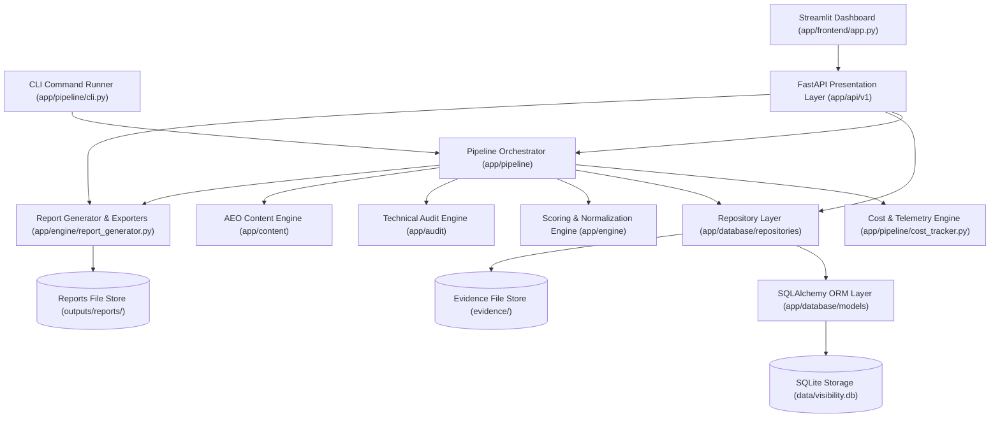
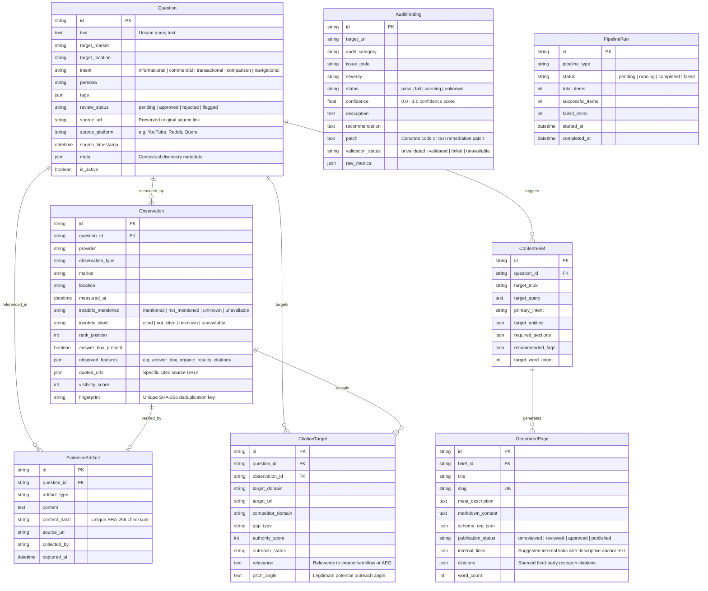
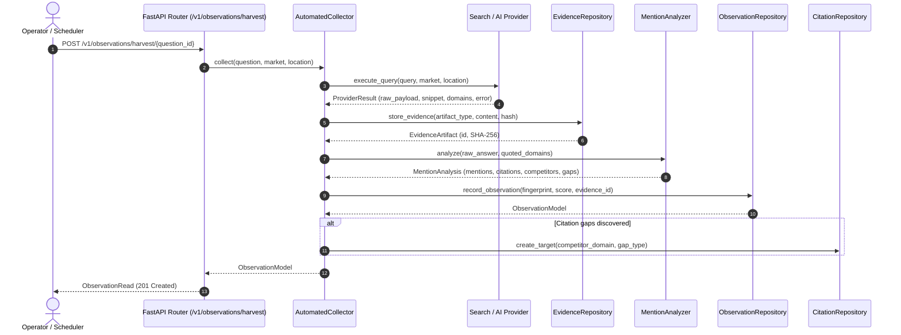

# IncuBrix Visibility Engine Architecture & Data Model

## System Overview

The IncuBrix Visibility Engine monitors, audits, and optimizes brand presence across Answer Engines (AEO), Search Engines (SEO), and Generative Search Engines (GEO).

---

## Entity-Relationship Architecture

---

## Ingestion & Collection Pipeline

---

## Implemented Modules

1. **Automated Collectors (`app/collectors/automated_collector.py`)**:
   Orchestrates querying providers, storing raw payload evidence with SHA-256 checksums, analyzing brand and competitor presence, scoring visibility heuristics, and saving deduplicated observations with daily deterministic fingerprints.

2. **External Providers (`app/providers/search_provider.py`, `app/providers/ai_provider.py`)**:
   Concrete implementations for Google SERP and Generative AI Assistant APIs. Gracefully handle timeouts, HTTP 429 rate limits, authentication failures, and unconfigured states without fabricating data.

3. **Mention & Citation Analyzer (`app/engine/mention_analyzer.py`)**:
   Evaluates search snippets and AI answers against target brand names and canonical domains. Enforces explicit tri-state enums (`mentioned`, `not_mentioned`, `unknown`, `unavailable`) and detects competitor citation gaps.

4. **Module 2: Question Ingestion Engine (`app/engine/question_ingestion.py`)**:
   Provides batch CSV import, RFC 4180 CSV export, source URL validation, provenance preservation (source platform, real discovery timestamps, curator notes), duplicate prevention, and automated search intent categorization (`informational`, `commercial`, `transactional`, `comparison`, `navigational`). Supports manual review status curation workflow (`pending`, `approved`, `rejected`, `flagged`).

5. **Module 3: SEO and AEO Collection (`app/collectors/manual_collector.py`, `app/providers/search_provider.py`)**:
   Permitted Google SERP adapter active only when credentials are configured. Extracts organic rank, answer box presence, quoted source URLs, and observed SERP features. Includes the Manual Evidence-Import Adapter preserving raw text/HTML/JSON evidence artifacts with SHA-256 deduplication and operator audit trails.

6. **Module 4: GEO Collector (`app/collectors/geo_collector.py`, `app/providers/ai_provider.py`)**:
   Shared `BaseAIProvider` interface with independent adapters for Perplexity AI, OpenAI/ChatGPT, Google Gemini Grounding, Anthropic Claude, and Google AI Overview. Refuses to claim unsupported assistants were queried. Enforces strict decoupling between textual brand mentions and direct website link citations. Supports manual assistant transcript imports (`GEOManualImportRequest`).

7. **Module 5: Visibility Scoring & Analytics (`app/engine/visibility_metrics.py`, `app/api/v1/scoring.py`)**:
   Calculates documented SEO, AEO, and GEO metrics: Top-10 ranking rate, Top-3 ranking rate, average rank position, answer-feature presence rate, AI brand mention rate, and AI direct citation rate. Strictly excludes non-success and unknown/unavailable observations from valid denominators and reports them separately. Provides daily fingerprint deduplication, multi-period comparative deltas, and cohort breakdowns by market, provider, and question.

8. **Module 6: Technical SEO Auditor (`app/audit/technical_audit.py`, `app/audit/html_inspector.py`, `app/api/v1/audit.py`)**:
   Inspects accessible public pages across indexability signals (meta robots `noindex`/`nofollow`, `X-Robots-Tag`, HTTP status), title and meta description bounds, heading hierarchy (`<h1>`, `<h2>`, `<h3>`), canonical links (presence, duplicates, relative paths), robots.txt rules (AI crawlers `GPTBot`/`ClaudeBot`/`PerplexityBot`, blanket disallows, sitemap directive), XML sitemaps (XML validation, URL containment), internal link health (placeholder/empty links, non-descriptive anchor texts), basic performance signals (latency thresholds, HTML payload size, render-blocking scripts, image alt attributes), and Schema.org JSON-LD structured data. Treats `/llms.txt` strictly as an optional discovery check, not a guaranteed ranking requirement. Produces evidence-backed findings with concrete code patches, recommendations, and strict fix validation workflows (`validate_fix`) that never claim a fix is validated without executing an appropriate check, marking unavailable checks explicitly.

9. **Module 7: Content and Citation Engine (`app/content/generator.py`, `app/content/validator.py`, `app/content/verified_knowledge.py`, `app/api/v1/content.py`, `app/api/v1/citation.py`)**:
   Generates ten publish-ready page drafts from approved creator questions, verified IncuBrix product capabilities, and sourced benchmark research. Places direct, fluff-free answers strictly within the first two sentences to maximize AEO/GEO answer box extraction. Equips every page with structured heading hierarchies, title and meta description length bounds, descriptive internal-link suggestions, verified third-party citations, and valid Schema.org JSON-LD (`TechArticle`, `HowTo`, `FAQPage`). Enforces a strict deterministic template fallback alongside optional configurable LLM providers without inventing capabilities or fake sources. Researches and persists 30 specific, real-world third-party citation opportunities complete with target URLs, relevance justifications, domain authority ratings, and legitimate outreach angles. Rigorously validates all content via `ContentValidator` and labels new drafts as `unreviewed` until verified through human curation workflows (`/v1/content/pages/{id}/review`).

10. **Module 8: Streamlit Dashboard and Report Generator (`app/frontend/app.py`, `app/engine/report_generator.py`, `app/api/v1/reports.py`, `app/schemas/reports.py`)**:
   Provides an interactive visual frontend and enterprise reporting engine:
   - **Overview Metrics & KPIs**: Live dashboard cards for mean visibility score, top-10 ranking rate, AI brand mention rate, and AI website citation rate calculated strictly from stored records.
   - **Provenance Mode Classification**: Systematically categorizes all observations into four explicit empirical modes: `real` (live automated queries), `manual` (human curator evidence imports), `mocked` (clearly labeled test fixtures), and `unavailable` (unconfigured/failed queries).
   - **Period Comparison Analytics**: Evaluates baseline vs. current reporting windows with delta point calculations across all visibility metrics.
   - **Question-Level Evidence Inspector**: Detailed inspection of raw answer payloads, ranking positions, SERP features, quoted source URLs, and competitor presences with colored provenance badges.
   - **Technical SEO & AEO Posture**: Health scores (0-100), critical defect counts, remediation patches, and verified vs. unvalidated status trackers.
   - **Content Curation Hub**: Full preview of generated drafts, direct answers, and interactive approval/rejection review actions.
   - **Citation Opportunity Matrix**: Exploration of 30 tracked citation targets with domain authority, relevance, and outreach pitch angles.
   - **RFC 4180 CSV Data Exports**: Downloadable `visibility.csv`, `technical_fixes.csv`, and `citation_targets.csv`.
   - **Weekly Executive Intelligence Reports**: Synthesizes structured markdown and JSON reports and persists copies to `outputs/reports/`.
   - **Empty-State Safety**: Every tab, API endpoint, and export function handles zero-record states gracefully without crashing or dividing by zero.

11. **Module 9: Pipeline Orchestration (`app/pipeline/orchestrator.py`, `app/pipeline/cli.py`, `app/pipeline/cost_tracker.py`, `app/pipeline/retry.py`)**:
   Integrates all visibility engine capabilities into a unified execution pipeline without duplicating business logic:
   - **Six-Stage Architecture**: Orchestrates Stage 1 (Ingestion & Input Loading), Stage 2 (Search & GEO Measurement), Stage 3 (Scoring & Analytics), Stage 4 (Technical SEO/AEO Audit), Stage 5 (Content & Citation Generation), and Stage 6 (Reporting & CSV Exports).
   - **Dual Execution Modes**: Complete end-to-end runs (`complete`) and measurement refresh runs (`refresh`) to evaluate fresh observations without regenerating static content.
   - **CLI Commands**: CLI entrypoints (`python -m app.pipeline.cli complete` and `python -m app.pipeline.cli refresh`) supporting filtering, bounded retries, and output summaries.
   - **Bounded Retries**: Automated exponential backoff and jitter on transient HTTP, network, and rate-limit errors (429, 500, 502, 503, 504, timeouts) while failing fast on permanent client/auth errors.
   - **Provider Failure Recovery**: Isolates individual external provider outages, persisting `failed` or `unavailable` states and continuing the pipeline without terminating healthy queries.
   - **Daily Fingerprint Idempotency**: Re-running measurements on the same UTC day reuses deterministic observation fingerprints without creating duplicate records or database constraint conflicts.
   - **Actual & Estimated Cost Telemetry**: Granular accounting of API calls and expenditures per provider and stage, backed by transparent published unit rate cards.
   - **Live Review Input Support**: Ingests and auto-approves small new input sets (e.g. `data/live_review_sample.csv`) for live verification and immediate scoring.
   - **Strict Non-Success Enforcement**: Returns non-zero exit codes and sets pipeline status to `FAILED` whenever required stages encounter unrecoverable errors.

---

## Interfaces for Subsequent Modules

The engine provides clean interfaces for upcoming modules:

1. **Scheduled Cron Runner / OS Service**:
   Triggers `python -m app.pipeline.cli refresh` on unattended recurring intervals via Windows Task Scheduler or cron.

2. **Multi-Tenant Workspace Partitioning**:
   Extends `QuestionModel` and `ObservationModel` with client organization identifiers for agency white-label deployments.
